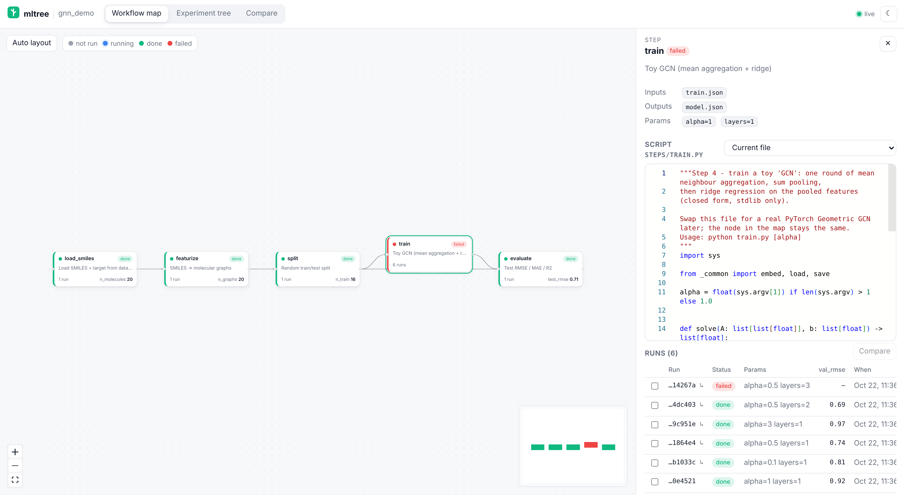
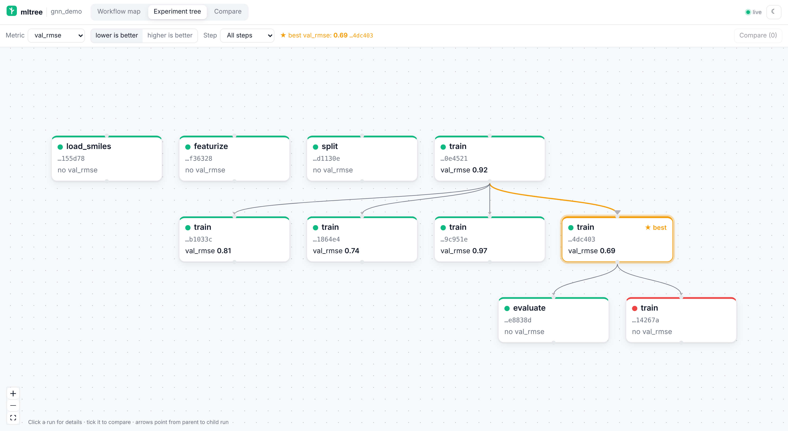
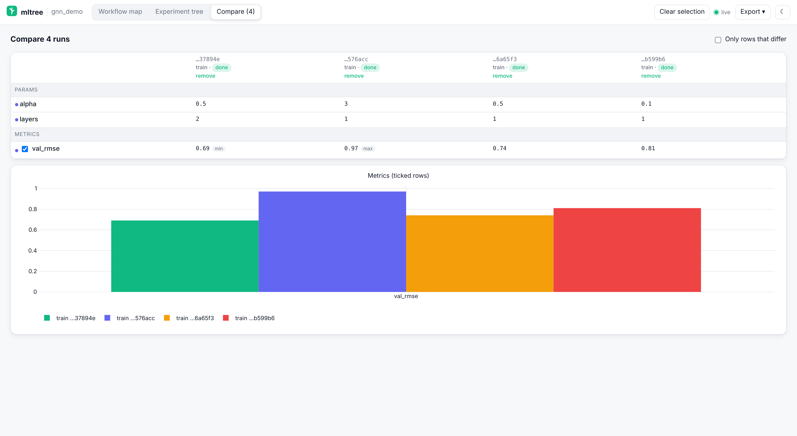

# mltree-mcp

**Your ML workflow as a node map, your experiments as a tree — filled in by your coding assistant as it works.**

`mltree-mcp` is an [MCP](https://modelcontextprotocol.io) server for Codex, Claude Code and any other MCP client.
While the assistant writes and runs your ML / QSAR / GNN code, it calls `mltree` tools to:

- register each pipeline step (load → clean → featurize / graph-build → split → HPO → train → evaluate) as a **node**, with its own `.py` script, inputs, outputs and default params;
- wire the steps into a **DAG**;
- log every execution as a **run** with params, metrics and artifacts, branching from a parent run (HPO trials, GNN variants…), so experiments form a **mind-map tree** instead of being scattered down a notebook.

Everything lives as plain files in your repo under `.mltree/`, and `mltree-mcp view` opens a KNIME-style map of it in your browser.





> Status: **0.3.0**. Phase 1 (MCP core), Phase 2 (map viewer) and Phase 3 (`scan_project` for existing projects) are done. The step runner, `fork_run` / `compare_runs` tools and Optuna integration are on the roadmap.

## Install

Requires Python 3.11+. Works with the MCP Python SDK 1.x (`FastMCP`) and 2.x (`MCPServer`).

```bash
# from a clone (until it is published on PyPI)
git clone https://github.com/yboulaamane/mltree-mcp
cd mltree-mcp
pip install -e .            # or: uv pip install -e ".[dev]"
mltree-mcp --version

# run without installing, straight from the folder or the git repo
uvx --from /path/to/mltree-mcp mltree-mcp --version
uvx --from git+https://github.com/yboulaamane/mltree-mcp mltree-mcp --version

# once published on PyPI
uvx mltree-mcp
```

The `mltree-mcp` command starts a **stdio** MCP server (that is what Claude Code and Codex expect). Clients launch it for you; you don't run it by hand.

### Which project does it use?

The project root is resolved on every call, in this order:

1. `--project <dir>` flag / `MLTREE_PROJECT` environment variable
2. `CLAUDE_PROJECT_DIR` (Claude Code sets this for stdio servers automatically)
3. the server's current working directory

## Add it to Claude Code

```bash
# once on PyPI
claude mcp add mltree -- uvx mltree-mcp

# before that, from your clone
claude mcp add mltree -- uvx --from /path/to/mltree-mcp mltree-mcp

# make it available in every project, or share it with the repo via .mcp.json
claude mcp add --scope user    mltree -- uvx mltree-mcp
claude mcp add --scope project mltree -- uvx mltree-mcp

claude mcp list        # should show: mltree ... ✔ Connected
```

Inside Claude Code, `/mcp` shows the server and its tools. Claude Code passes `CLAUDE_PROJECT_DIR`, so the store lands in the project you opened.

## Add it to Codex

Either use the CLI:

```bash
codex mcp add mltree -- uvx mltree-mcp
codex mcp list
```

or edit `~/.codex/config.toml` (or a project-scoped `.codex/config.toml` in a trusted project):

```toml
[mcp_servers.mltree]
command = "uvx"
args = ["mltree-mcp"]
# before PyPI: args = ["--from", "/path/to/mltree-mcp", "mltree-mcp"]
startup_timeout_sec = 20   # first uvx run downloads dependencies

# Optional: pin the project instead of using the directory Codex starts in
# [mcp_servers.mltree.env]
# MLTREE_PROJECT = "/home/you/projects/qsar-gnn"
```

In the Codex TUI, `/mcp` lists active servers. Codex also reads the server's built-in `instructions`, which tell it when to call each tool.

## Use it on an existing project over SSH with Codex

You already have a project on a GPU server: numbered scripts, a `utils.py`, a notebook or two, some `metrics.json`
files, maybe `mlruns/` or an Optuna study. `scan_project` builds the map from that code **without running any of it**.
It parses scripts with Python's `ast` and reads notebooks as JSON.

**1. Install on the server** (once):

```bash
ssh you@server
pip install --user "git+https://github.com/yboulaamane/mltree-mcp"   # or: uv tool install git+https://github.com/yboulaamane/mltree-mcp
mltree-mcp --version
```

**2. Register it with Codex on the server**, pinned to the project:

```bash
codex mcp add mltree -- mltree-mcp --project /path/to/your/project
```

**3. Ask Codex to scan it.** Start `codex` in the project and say:

> Scan this project with mltree and show me the map. Fix anything the scan got wrong.

Codex calls `scan_project` (the server instructions tell it to do this first on an existing project). It reviews
the summary and corrects edges or kinds with `connect_steps` / `add_step`. You can also scan from the shell:

```bash
mltree-mcp scan --project /path/to/your/project --dry-run   # preview, writes nothing
mltree-mcp scan --project /path/to/your/project             # write .mltree/
```

**4. Look at it from your laptop.** On the server:

```bash
mltree-mcp view --project /path/to/your/project      # serves on localhost:8765 on the server
```

On your laptop:

```bash
ssh -L 8765:localhost:8765 you@server
# then open http://localhost:8765
```

### What the scan detects

| Signal | How |
| --- | --- |
| Data reads / writes | `pd.read_*` / `.to_*`, `open()` (by mode), `np.load/save`, `torch.load/save`, `joblib`, `pickle`, `json`, `yaml`, `Path.read_*/write_*`, `h5py`, `shutil.copy`, RDKit / PyG loaders, project helpers such as `load("x.json")` / `save(obj, "y.pkl")`. Paths are folded from string constants, f-strings, `Path(__file__).parent / "data"`, `os.path.join`, and argparse / click defaults. |
| Params | argparse `add_argument` and click `@option` defaults, `sys.argv[...] if ... else default`, UPPERCASE numeric constants, and literal kwargs like `test_size`, `random_state`, `n_trials`, `lr`, `epochs`. |
| Description | The module docstring, or the notebook's first markdown heading. |
| Kind | `data / clean / split / featurize / hpo / train / eval`, from the file name, imports and calls. For example, `optuna.create_study` gives hpo, `train_test_split` gives split, `.fit` or `optimizer.step()` gives train, and `sklearn.metrics` gives eval. |
| Utilities | A helper module such as `utils.py` (imported, with no entry point and no I/O) is not a step. It is noted in the description of each step that uses it. |
| Edges | 1) one step's output path matches another's input (exact, glob, or folder); 2) imports of other step modules; 3) notebook section order; 4) file numbering (`01_`, `step2_`) for steps that have no other upstream. Cycles are never added. |
| Notebooks | One step per notebook, or one step per markdown-headed section with `notebook_sections=true`. Magics are ignored. |
| Existing results → runs tagged `imported` | `*metrics*.json` / `*results*.csv` style files; MLflow `mlruns/` (params, last metric values, status); Optuna SQLite studies (one parent run per study, trials as child runs, categorical params decoded, read-only); Lightning `lightning_logs/version_*` (hparams + last `metrics.csv` values); wandb offline runs (summary + config). TensorBoard event files are noted but not parsed. |

Re-scanning is safe. Steps the scanner owns are refreshed, new scripts become new steps, and nothing is deleted.
A step you or the assistant edited with `add_step` keeps its description, kind and param values; the scan only adds
new inputs, outputs and param keys. Results are imported once (they are keyed by source). The summary lists new,
updated, merged and unchanged steps, edges, inputs no step produces, outputs no step consumes, skipped files, and
imported runs. Default excludes: virtualenvs, `.git`, `tests/`, `test_*.py`, `__pycache__`, `.mltree`,
`node_modules`, `build/`, `dist/`.

## The map viewer

```bash
mltree-mcp view                                   # project = $MLTREE_PROJECT / cwd
mltree-mcp view --project ~/projects/qsar-gnn --port 8765
# then open http://localhost:8765
```

Or ask the assistant: it calls `open_map`, which starts the viewer in the background if needed and returns the URL.

- **Workflow map.** Your steps form a DAG, coloured by each step's latest run (grey not run, blue running, green done, red failed). Nodes are laid out automatically (dagre). If you drag them, their positions are saved to the store (`pos_x` / `pos_y`), and **Auto layout** resets them.
- **Step panel.** Click a node to see its inputs, outputs and params, and a read-only editor (Monaco, the VS Code editor) showing the script. A dropdown switches between the **current file** and the **snapshot saved with each run**, marked "same as current" or "changed". Below it is the step's runs table.
- **Experiment tree.** All runs form a mind-map built from `parent_run_id`. Pick a metric and "lower/higher is better" to highlight the best run (★). You can filter by step.
- **Compare.** Tick 2 or more runs anywhere to get a params/metrics table (rows that differ are marked) and a grouped Plotly bar chart.
- **Live.** The page updates by itself as the assistant logs runs, using Server-Sent Events with polling as a fallback. Dark and light themes follow your OS and can be toggled.

The built frontend ships inside the Python package (`src/mltree_mcp/static/`), so `pip install` needs no Node. Monaco is bundled too, with no CDN, so it works offline and on air-gapped clusters.



### On a remote server or HPC cluster

The viewer binds to `127.0.0.1` by default. Run it on the server and tunnel the port from your laptop:

```bash
# on the server (or let the assistant call open_map there)
mltree-mcp view --project ~/projects/qsar-gnn

# on your laptop
ssh -L 8765:localhost:8765 you@server
# open http://localhost:8765
```

Use `--host 0.0.0.0` only on a network you trust. The viewer has no authentication, and position saving is its only write.

### HTTP API

| Route | Returns |
| --- | --- |
| `GET /api/health` | project, root, `revision` (bumped on every store change) |
| `GET /api/pipeline` | nodes (params, script, position, latest run status), edges, order |
| `PUT /api/positions` | body `{"positions": {"step": {"x": 0, "y": 0} \| null}}` |
| `GET /api/steps/{step}` | one node |
| `GET /api/steps/{step}/script[?run_id=]` | current script, or the snapshot stored with a run |
| `GET /api/steps/{step}/snapshots` | runs of the step that carry a script snapshot |
| `GET /api/runs[?step=&status=&parent_run_id=&limit=]` | runs, newest first |
| `GET /api/runs/{run_id}` | one run |
| `GET /api/tree[?metric=&mode=min\|max&step=]` | run forest (runs, edges, roots) and the best run |
| `GET /api/compare?ids=a,b[,c]` | runs, param/metric keys and which ones differ |
| `GET /api/metrics` | numeric metric names |
| `GET /api/events` | `text/event-stream` of `revision` events |

## Tools

| Tool | What the assistant uses it for |
| --- | --- |
| `scan_project(path=".", include?, exclude?, dry_run=False, notebook_sections=False, import_results=True)` | Build the map of an **existing** project by static analysis (never runs your code): steps, params, edges, utilities, and existing results imported as runs. Idempotent; `dry_run` previews. See [above](#use-it-on-an-existing-project-over-ssh-with-codex). |
| `init_project(name?)` | Create `.mltree/` (pipeline.yaml, mltree.db, runs/) in the project. Idempotent. |
| `add_step(name, script_path?, inputs?, outputs?, params?, description?)` | Register a node, or update it if the name exists. Script paths are relative to the project and may not escape it. |
| `connect_steps(source, target, label?)` | Add an edge. Both steps must exist; self-loops and cycles are rejected; warns when outputs and inputs don't match. |
| `get_pipeline()` | Nodes (script, params, latest run status, run count), edges and a topological order. |
| `log_run(step, params?, metrics?, artifacts?, parent_run_id?, notes?, status?, tags?)` | Record a run. Metrics must be numbers. Artifacts ≤ 50 MB are copied into `.mltree/runs/<run_id>/artifacts/`; bigger ones are referenced. The step's script is snapshotted with its SHA-256 and the git commit. |
| `list_runs(step?, status?, parent_run_id?, limit?)` | Runs, newest first. |
| `best_run(metric, mode="max"\|"min", step?)` | Best **succeeded** run by a metric. |
| `open_map(start=True, port?)` | URL of the map viewer. It starts `mltree-mcp view` in the background if the viewer isn't running, and includes the `ssh -L` tip for remote servers. |

Resource: **`mltree://pipeline`** — the same JSON as `get_pipeline`.

Errors come back as normal MCP tool errors with a message the assistant can act on (e.g. *"Unknown step 'trian'. Known steps: split, train"*).

## Project layout

```
your-project/
├── steps/                      # one script per node (your code)
│   ├── featurize.py
│   └── train_gcn.py
└── .mltree/
    ├── pipeline.yaml           # nodes, edges, default params — commit this
    ├── mltree.db               # SQLite: steps, edges, runs
    └── runs/<run_id>/
        ├── run.json            # params, metrics, parent, status, timestamps
        ├── script.py           # snapshot of the step script for this run
        └── artifacts/          # copied outputs (plots, small models…)
```

`mltree.db` is the source of truth; `pipeline.yaml` is rewritten on every change so it diffs well in git. If you commit only `pipeline.yaml`, a fresh clone rebuilds the steps and edges from it. Whether you commit `mltree.db` and `runs/` is up to you.

## Tell your assistant to use it (AGENTS.md / CLAUDE.md)

Codex reads `AGENTS.md`, Claude Code reads `CLAUDE.md`. Paste this into either:

```markdown
## Experiment tracking with mltree (MCP)

This repo tracks its ML workflow with the `mltree` MCP server. Keep the map up to date as you work:

- At the start, call `get_pipeline`. If the project is not initialized and already has code, call `scan_project`
  (`dry_run=true` first to preview) and fix its proposals; for a brand-new project call `init_project`.
- Put each pipeline stage in its own script under `steps/` (e.g. `steps/split.py`, `steps/train_gcn.py`).
  Whenever you create or materially change one, call `add_step` with its name, `script_path`,
  `inputs`, `outputs`, default `params` and a one-line `description`.
- Call `connect_steps` for every data dependency (upstream → downstream).
- After every execution of a step, call `log_run` with the exact `params` used, numeric `metrics`,
  produced `artifacts` (plots, model files) and `status` ("failed" if it crashed, with the error in `notes`).
- When a run is a variation of an earlier one (HPO trial, new architecture, different split seed),
  pass that run's id as `parent_run_id` so the experiment tree branches correctly.
- To answer "which model was best?" use `best_run` (mode "min" for losses/RMSE, "max" for AUC/R²)
  and `list_runs`; don't guess from memory.
- When the user wants to see the workflow, call `open_map` and give them the URL.
```

## Demo: a tiny GNN pipeline

`examples/gnn_demo/` is a toy molecular-property pipeline: load SMILES → featurize to graphs → split → train a toy GCN (mean aggregation + ridge, stdlib only) → evaluate. It runs without torch; `featurize.py` uses RDKit if installed.

```bash
cd examples/gnn_demo
python steps/load_smiles.py && python steps/featurize.py && python steps/split.py 0.2 42 \
  && python steps/train.py 1.0 && python steps/evaluate.py

# register the steps and log a few FAKE runs (tagged "demo") to see the tree
python register_demo.py --reset
mltree-mcp view --project .            # http://localhost:8765
```

The values in `data/molecules.csv` and the metrics logged by `register_demo.py` are illustrative demo data, not real measurements.

## Development

```bash
uv venv && uv pip install -e ".[dev]"
pytest -q
```

The tests cover:
- the store, and every tool called in-process through the MCP server
- the `mltree://pipeline` resource and the demo
- a smoke test that launches the stdio server and talks to it with the MCP client SDK
- every viewer API route, the SPA fallback, the live event stream and `open_map`

Frontend (React + TypeScript + Vite + React Flow + Monaco + Plotly) lives in `frontend/`:

```bash
cd frontend && npm install
npm run dev          # http://localhost:5173, proxies /api to a running `mltree-mcp view`
npm run build        # type-checks and writes the bundle into src/mltree_mcp/static/ (commit it)
```

Screenshots: `pip install -e ".[screenshots]" && playwright install chromium`, start the viewer on the demo, then `python scripts/screenshots.py`. If you have a local Chrome, use `--chrome /usr/bin/google-chrome` instead of installing Playwright's browser.

## Roadmap

1. **MCP core** ✅
2. **Map viewer** ✅ (map, script panel with run snapshots, experiment tree, compare, live refresh)
3. **`scan_project`** ✅ (static import of existing projects and their MLflow / Optuna / Lightning / wandb results)
4. `run_step` with caching and live logs; `fork_run` / `compare_runs` tools; loss curves
5. Optuna-callback trials as live branches; RDKit / PyG starter steps (GCN, GAT)
6. PyPI release, Claude Code plugin bundle with slash commands, demo site

## License

MIT © Yassir Boulaamane
